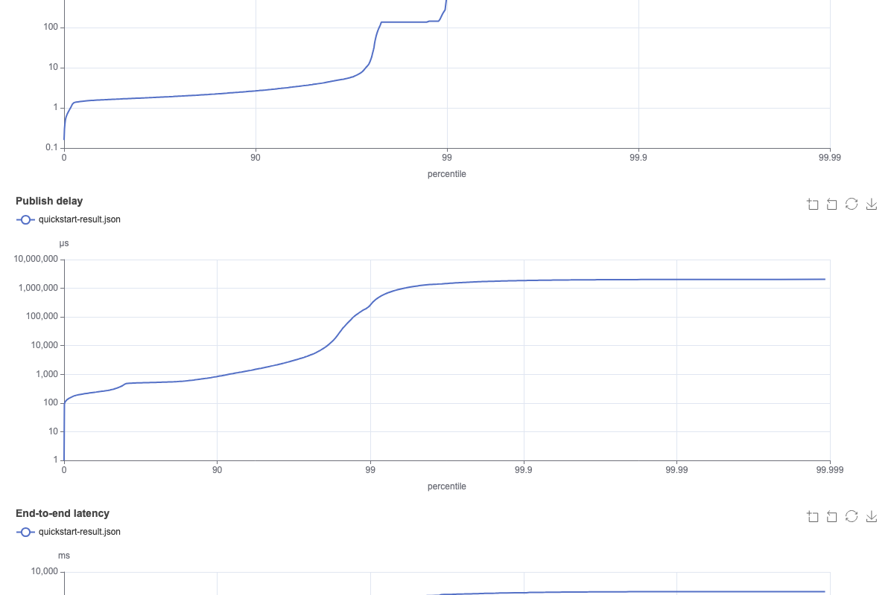

<!--
Licensed under the Apache License, Version 2.0 (the "License");
you may not use this file except in compliance with the License.
You may obtain a copy of the License at

http://www.apache.org/licenses/LICENSE-2.0

Unless required by applicable law or agreed to in writing, software
distributed under the License is distributed on an "AS IS" BASIS,
WITHOUT WARRANTIES OR CONDITIONS OF ANY KIND, either express or implied.
See the License for the specific language governing permissions and
limitations under the License.
-->

# HTML report

`bin/benchmark-report html` renders one or more result files as a single HTML page with interactive
charts. Each file is one run; pass several to overlay them.

```bash
bin/benchmark-report html results/kafka-1x.json results/kafka-2x.json -o report.html
```

To write the report at the end of a benchmark, add `--report-html` to `bin/benchmark`. The report
then covers every workload and driver combination of that invocation:

```bash
bin/benchmark -d driver-kafka/kafka-latency.yaml --report-html report.html workloads/simple.yaml
```



The page embeds the results as JSON and loads [Apache ECharts](https://echarts.apache.org/) from
`cdn.jsdelivr.net`, so it needs network access to draw the charts.

## Charts

|              Chart               |                                                                                        What it shows                                                                                         |
|----------------------------------|----------------------------------------------------------------------------------------------------------------------------------------------------------------------------------------------|
| Latency percentile spectrum      | Aggregated publish latency, publish delay and end-to-end latency by percentile. The x axis gives each extra nine (90, 99, 99.9, …) the same width, so the tail is visible. One line per run. |
| Throughput and backlog over time | Publish and consume rate per 10-second period, with the target rate as a dashed line; MB/s lines are in the legend, off by default. Below: backlog and publish errors per second.            |
| Latency over time                | Publish p50, p99, p99.9 and max per period, schedule-corrected publish latency, and publish delay on a second axis. More series are in the legend.                                           |
| Throughput vs p99 latency        | Shown with two or more runs: one point per run, ordered by publish rate, to show where latency bends upward.                                                                                 |

Click legend entries to hide or show series, drag on a chart or use the slider to zoom, and use the
toolbox to reset or save a chart as an image. The page follows the system light or dark theme.

The header lists each run's workload, driver and, for results written by this version, the run
metadata: version, Git commit, JDK, JVM options, worker count and the driver configuration with
secrets masked. Older result files without metadata still render.
